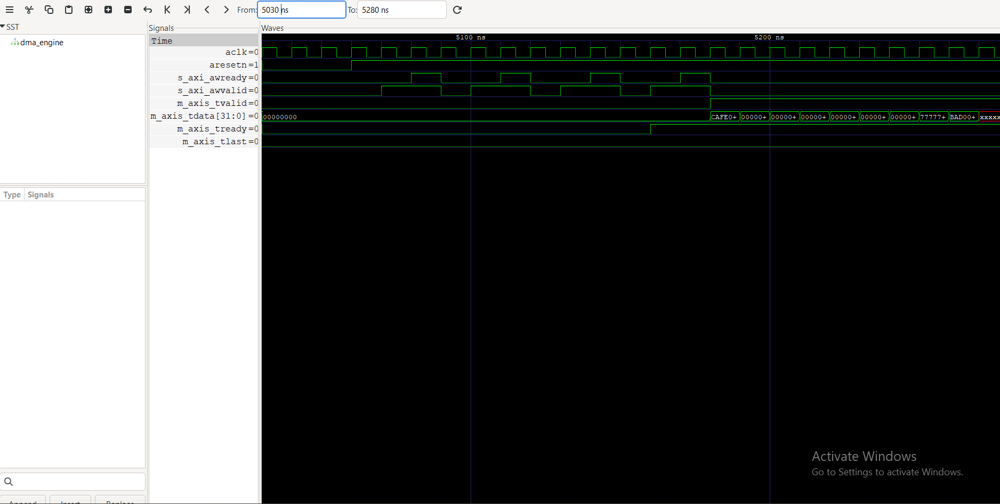
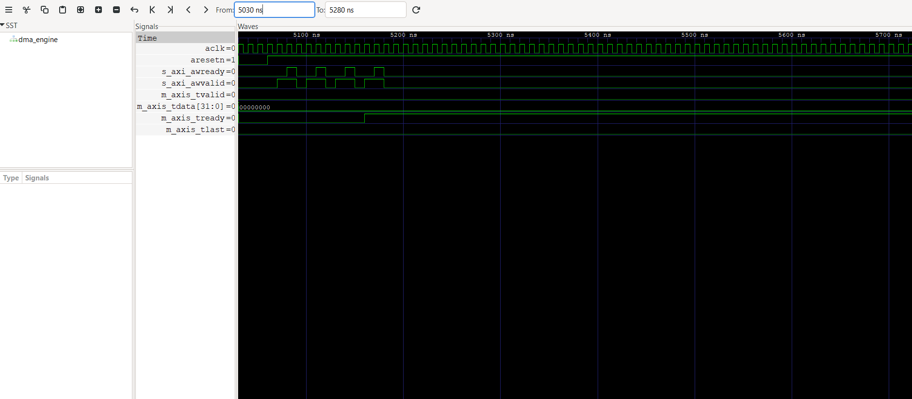

# AXI DMA Controller


A simple DMA engine written in SystemVerilog, verified with cocotb and Icarus Verilog.


## Features


- AXI4-Lite slave interface for register and SRAM access

- AXI-Stream master output with `tvalid`/`tready` backpressure and `tlast`

- 16-word internal SRAM


## Register map


| Address | Name | Description |

|---------|------|-------------|

| 0x00 | CTRL | Write 1 to start the DMA |

| 0x04 | STATUS | Bit 0 = DMA active (read only) |

| 0x08 | SRC_ADDR | SRAM word index to start reading from |

| 0x0C | XFER_LEN | Number of words to transfer |

| 0x100-0x13C | SRAM | 16 words of internal memory |


## Waveform


The 1-word transfer (`DEADBEEF`, `tvalid` and `tlast` high together) and the start of the 4-word transfer, viewed in GTKWave:


## Bug found and fixed: zero-length transfer

**Bug:** writing `XFER_LEN = 0` and then START made the DMA run forever. The last-word check `count == length - 1` can never match when `length` is 0 (the subtraction wraps around), so `tlast` never went high. The DMA kept streaming SRAM contents, including leftover data and uninitialised `X` values.

**Found by:** the `test_dma_zero_length` cocotb test, which expects no output for a zero-length transfer.

**Before the fix:** `tvalid` stays high and `tlast` never rises.



**Fix:** the DMA now ignores a START command when `XFER_LEN` is 0 (`if (s_axi_wdata[0] && length != 0)`).

**After the fix:** `tvalid` and `tlast` stay low for the whole test.



## Run the test


```

make

```


Requires Python, cocotb and Icarus Verilog.


## Verification


`test_dma.py` contains 6 cocotb tests:


- 1-word transfer

- 4-word transfer

- Random backpressure (8 words, `tready` toggling)

- Non-zero `SRC_ADDR` (start at SRAM[5])

- Back-to-back transfers without reset

- Zero-length transfer (found a real bug, see above)

